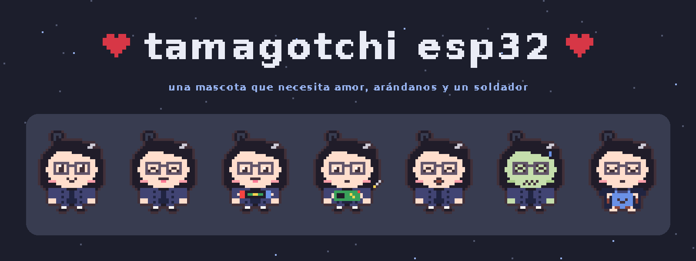
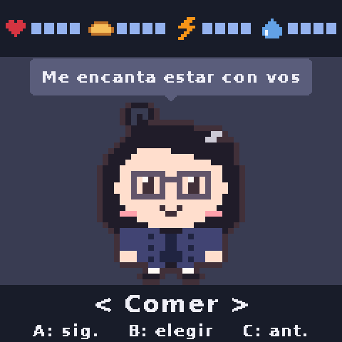
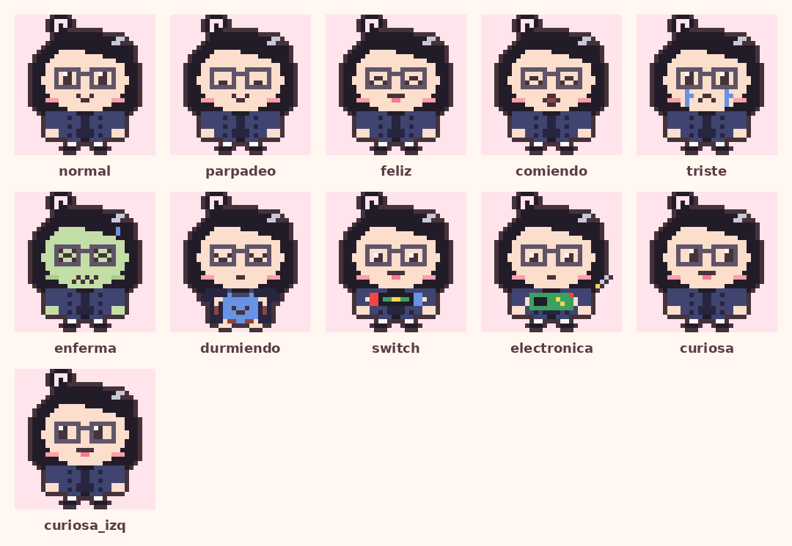
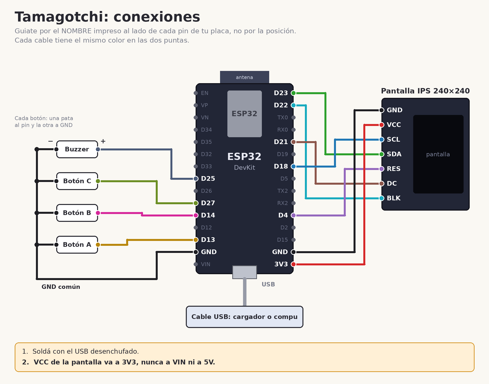
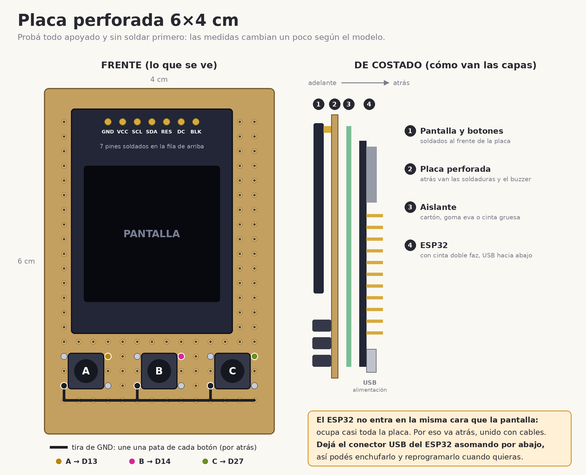
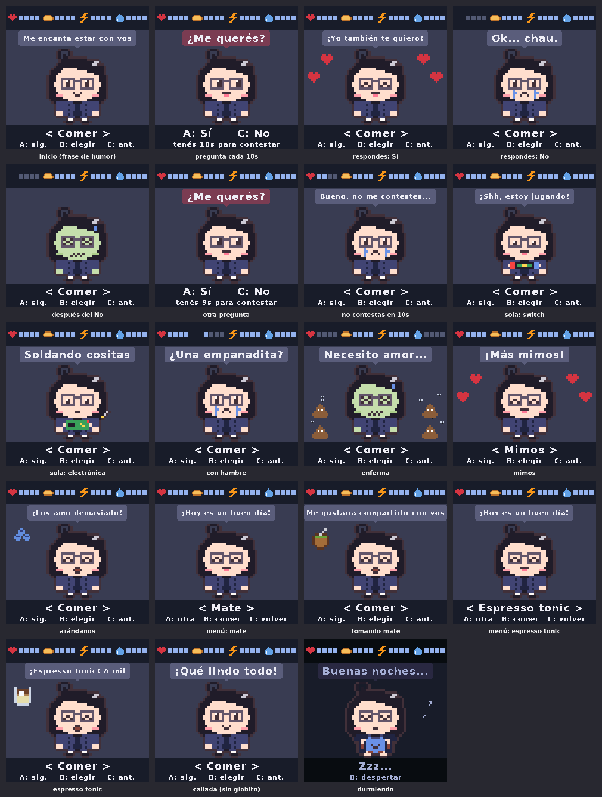

<p align="center">
  
</p>

<p align="center">
  
  
  
  
</p>

<p align="center">
  Un tamagotchi personalizado: la mascota soy yo.<br>
  Habla, pide amor, come arándanos, juega a la Switch, suelda plaquitas<br>
  y se pone verde si no la cuidás.
</p>

<p align="center">
  
</p>

<br>

## ♡ Qué hace

| | |
|---|---|
| **Estadísticas** | Amor, hambre, energía e higiene |
| **Menú** | Comer, Mimos, Jugar, Limpiar, Dormir, Estado y Sonido |
| **Comidas** | Arándanos (la que más llena), empanada, alfajor, mate y espresso tonic |
| **Frases** | Cambian según su humor, en un globito arriba del personaje |
| **"¿Me querés?"** | Pregunta si pasan 10 segundos sin tocar botones. **Sí** mantiene el amor, **No** lo baja a 0 y no contestar lo baja a la mitad |
| **Sola** | Se pone a jugar a la Switch, a soldar o a mirar para los costados |
| **Enferma** | Si el amor o el hambre llegan a 0, o se juntan 4 caquitas. Se cura con limpieza y mimos |
| **Sonidos** | Melodía de inicio, respuestas, comidas, alarma y avisos |
| **Progreso** | Se guarda solo cada 30 segundos y después de cada acción |

<p align="center">
  
</p>

<br>

## ♡ Materiales

- ESP32 DevKit (ESP-WROOM-32)
- Pantalla IPS 240×240 con controlador ST7789, de 7 pines (sin CS)
- 3 pulsadores
- Buzzer pasivo
- Placa perforada de 6×4 cm
- Cable USB para alimentarlo

<br>

## ♡ Conexiones

<p align="center">
  
</p>

| Componente | Pin | ESP32 |
|---|---|---|
| Pantalla | GND | GND |
| Pantalla | VCC | 3V3 |
| Pantalla | SCL | GPIO 18 |
| Pantalla | SDA | GPIO 23 |
| Pantalla | RES | GPIO 4 |
| Pantalla | DC | GPIO 21 |
| Pantalla | BLK | GPIO 22 |
| Botón A | una pata | GPIO 13 |
| Botón B | una pata | GPIO 14 |
| Botón C | una pata | GPIO 27 |
| Buzzer | + | GPIO 25 |
| Botones y buzzer | la otra pata | GND |

> El VCC de la pantalla va a 3V3, nunca a 5V.

<details>
<summary><b>Ubicación sugerida en la placa perforada</b></summary>
<br>
<p align="center">
  
</p>
</details>

<br>

## ♡ Cómo cargarlo

1. Instalá [Thonny](https://thonny.org) y cargale MicroPython al ESP32 desde
   **Herramientas → Opciones → Intérprete → Instalar o actualizar MicroPython**.
2. Abrí **Ver → Archivos**.
3. Subí al ESP32 los cuatro archivos de la carpeta [`esp32/`](esp32):
   `main.py`, `pantalla.py`, `sprites.py` y `fuente.bin`.
4. Reiniciá el ESP32 con **Ctrl + D**. El juego arranca solo.

<br>

## ♡ Controles

| Botón | Función |
|:---:|---|
| **A** | Siguiente opción · responder **Sí** |
| **B** | Elegir |
| **C** | Opción anterior, volver · responder **No** |

<br>

## ♡ Ajustes

Están al principio de [`esp32/main.py`](esp32/main.py):

| Ajuste | Qué cambia |
|---|---|
| `VELOCIDAD` | Poné 30 para probar: todo pasa 30 veces más rápido |
| `VOLUMEN` | Volumen del buzzer, de 1 a 100 |
| `SONIDO_BOTONES` | Clic al apretar cada botón |
| `BUZZER_ACTIVO` | `True` si tu buzzer es activo (solo pita) |
| `SEG_PARA_PREGUNTAR` | Segundos sin tocar nada antes de "¿Me querés?" |
| `SEG_PARA_ACTIVIDAD` | Segundos sin tocar nada antes de ponerse a jugar o soldar |
| `FRASES`, `PREGUNTAS` | Todo lo que dice |
| `COMIDAS` | Comidas, cuánto llenan y qué dice al comerlas |
| `MELODIAS` | Sonidos, como pares de frecuencia y duración |

Para empezar de cero, borrá el archivo `estado.json` del ESP32.

<br>

## ♡ Archivos

```
esp32/               lo que va adentro del ESP32
  main.py            el juego
  pantalla.py        driver de la pantalla ST7789 y dibujo de texto
  sprites.py         los dibujos del personaje (generado)
  fuente.bin         las letras, con tildes y ñ (generado)
herramientas/        scripts para la compu (Python 3 y Pillow)
  gen_sprites.py     dibuja el personaje y genera esp32/sprites.py
  gen_fuente.py      genera esp32/fuente.bin
  gen_diagramas.py   genera los esquemas de docs/
  gen_banner.py      genera la portada de este README
  simular.py         corre el juego en la compu y saca capturas
docs/                imágenes
```

<details>
<summary><b>Cambiar el personaje</b></summary>
<br>

El personaje se dibuja en `herramientas/gen_sprites.py`, en una grilla de 32×32 píxeles.
Después de editarlo:

```
pip install pillow
python herramientas/gen_sprites.py
```

Eso actualiza `esp32/sprites.py` y la vista previa `docs/sprites.png`.
</details>

<details>
<summary><b>Probar sin el ESP32</b></summary>
<br>

```
python herramientas/simular.py
```

Simula la pantalla y los botones, recorre las situaciones principales y guarda
`docs/capturas_juego.png` y `docs/demo.gif`.

Los scripts de `herramientas/` usan la tipografía DejaVu Sans, que viene instalada en Linux.
En otros sistemas hay que cambiar la ruta de la fuente al principio de cada script.
</details>

<details>
<summary><b>Todas las pantallas</b></summary>
<br>
<p align="center">
  
</p>
</details>

<br>

<p align="center">♡</p>
